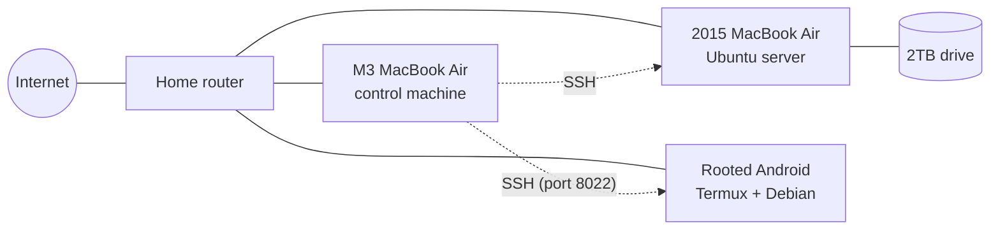

# home-network

A home server and network built from hardware I already owned: a 2015 MacBook Air, a rooted Android phone and a 2TB external drive. Every step is written down as it happens, with screenshots, so you can follow along or repeat it on your own gear.

> **Privacy note:** IP addresses, usernames, device names, serial numbers and keys are replaced with placeholders like `<server-ip>`. See [SANITIZING.md](SANITIZING.md) for how that is done and enforced.

## The hardware

| Device | Role | Specs |
|---|---|---|
| MacBook Air, 13-inch, Early 2015 | **Main server.** Ubuntu, Docker, storage and network services | Intel Core i5 1.6 GHz dual core, 8 GB RAM, 128 GB SSD |
| 2TB external hard drive | **Storage.** Backups, media, Docker data | USB 3 |
| Motorola moto g stylus 5G (2022), rooted | **Second node.** Backup DNS, uptime watchdog, alerts | Android 13, Termux, Debian container |
| NinePlus 802.11ac USB Wi-Fi adapter | **Backup Wi-Fi** for the server | Realtek RTL8812BU |
| MacBook Air (M3) | **Control machine.** SSH, editing, these docs | |



## Progress

- [x] [Plan: what goes where, and why](docs/01-plan.md)
- [x] [Connect from the control Mac with an SSH key](docs/02-ssh-key.md)
- [x] [Back up the old Mac before wiping it](docs/03-backup.md)
- [x] [Check the hardware: battery, Wi-Fi chip, USB adapter](docs/04-hardware-check.md)
- [x] [Android phone as a Linux node](android/README.md) (built earlier, documented here)
- [x] [Write the Ubuntu installer to the 2TB drive](docs/05-installer-drive.md)
- [x] [Install Ubuntu and hand it over to SSH](docs/06-install-ubuntu.md) (lid ignored, sleep off, key-only SSH)
- [x] [Reformat the 2TB drive as server storage](docs/07-storage.md)
- [x] [Unlock the encrypted disk over Wi-Fi from the main Mac](docs/08-remote-unlock.md)
- [x] [Tailscale: reach everything from anywhere, exit node](docs/09-tailscale.md)
- [x] [Phone as ad blocker (AdGuard Home), battery held at 45 to 50%](docs/10-adguard-and-battery.md)
- [x] [Wazuh SIEM, data on the 2TB drive](docs/11-wazuh.md)
- [x] [Wazuh agent on the main Mac](docs/11-wazuh.md#step-5-the-agent-on-the-main-mac)
- [x] [Backup ad-blocking DNS on the server](docs/12-backup-dns.md)
- [x] [Firewall and automatic security updates](docs/13-firewall-and-updates.md)
- [ ] More services: Time Machine share, Uptime Kuma

## How these docs are made

- Commands are run for real, and the output is captured as text.
- `scripts/sanitize.py` swaps sensitive values for placeholders.
- `scripts/term-screenshot.py` turns the cleaned text into the terminal screenshots you see here.
- A pre-commit hook (`scripts/check-sensitive.sh`) blocks any commit that still contains a sensitive value.
- Steps that happen on a physical screen before the network is up (startup menu, installer) are written as text only.

## Repo layout

```
docs/          step-by-step guides, in order
android/       the Android phone node
screenshots/   cleaned screenshots used in the guides
scripts/       sanitizing, screenshot and setup scripts
.githooks/     pre-commit safety check
```
