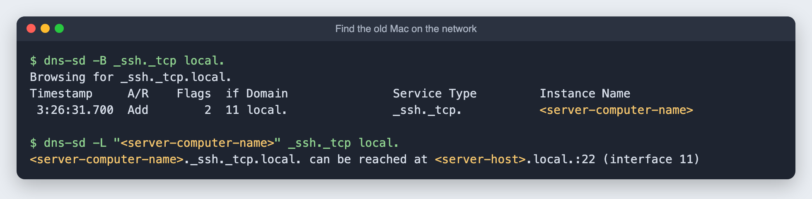
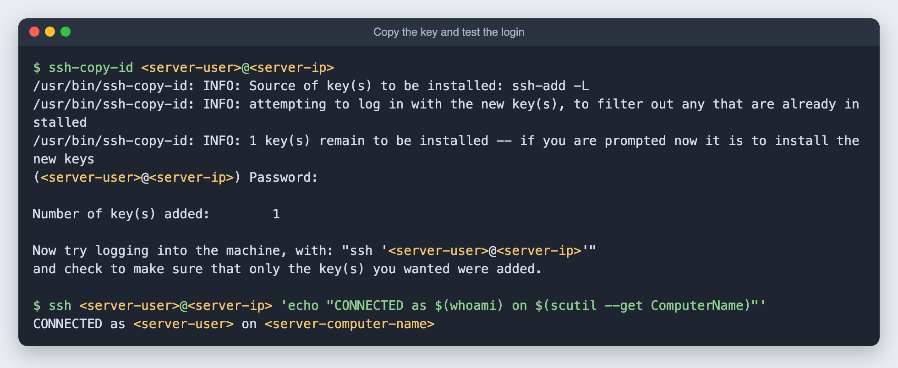
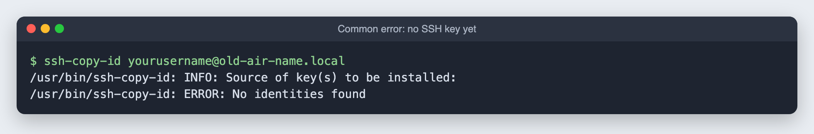

# 2. Connect from the control Mac with an SSH key

**Goal:** log in to the old Mac from your main Mac without typing a password every time. Everything later in this guide runs this way.

**Time:** about 10 minutes.

## Step 1: turn on Remote Login on the old Mac

On the old Mac: **System Preferences > Sharing**, then tick **Remote Login**.

The panel shows the exact login line, something like `ssh <server-user>@<server-host>.local`. Note the part before the `@`: that is the username you will use.

## Step 2: find the old Mac from the main Mac

Macs announce themselves on the local network. This lists every Mac with Remote Login on:

```bash
dns-sd -B _ssh._tcp local.
```

Press **Control + C** to stop it. To get the address of one machine:

```bash
dns-sd -L "<server-computer-name>" _ssh._tcp local.
```



Tip: give the old Mac a fixed address in your router (often called a "DHCP reservation") so the address never changes.

## Step 3: create a key on the main Mac

```bash
ssh-keygen -t ed25519
```

It asks three questions:

1. **Where to save the key:** press **Return** to keep the default (`~/.ssh/id_ed25519`).
2. **Passphrase:** type one and press **Return**. Nothing shows on screen while you type, not even dots. That is normal.
3. **Passphrase again:** type it again and press **Return**.

A square of random characters means the key was made.

## Step 4: save the passphrase in the macOS keychain

So you are not asked for it every time:

```bash
ssh-add --apple-use-keychain ~/.ssh/id_ed25519
```

## Step 5: copy the key to the old Mac

Replace the placeholders with your username and the old Mac's address. It asks for the **old Mac's login password** once.

```bash
ssh-copy-id <server-user>@<server-ip>
```

It worked when you see `Number of key(s) added: 1`. Test it. This should log in with no password:



## Common mistakes

**`ERROR: No identities found`** means step 3 has not been done yet, so there is no key to copy. It also happens if you paste an example command without changing the placeholder names.



**`Operation timed out`** usually means the old Mac went to sleep or is installing an update. On the old Mac, turn on **System Preferences > Battery > Power Adapter > Prevent computer from sleeping automatically when the display is off.**

**`Host key verification failed`** means your Mac has not seen this machine before and refused to ask in a script. Run a plain `ssh <server-user>@<server-ip>` once and answer `yes`.

Next: [back up the old Mac](03-backup.md).
