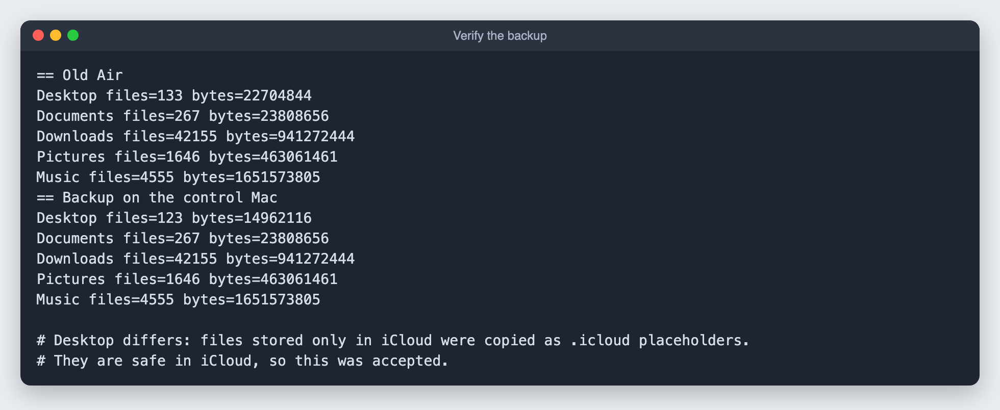

# 3. Back up the old Mac before wiping it

**Goal:** copy everything worth keeping onto the main Mac, over Wi-Fi, and prove the copy is complete. Installing Ubuntu erases the old Mac's drive.

**Time:** 10 to 20 minutes for about 5 GB.

## Step 1: see what is there

Over SSH, list folder sizes:

```bash
ssh <server-user>@<server-ip> 'cd ~ && du -sh Desktop Documents Downloads Pictures Music Library'
ssh <server-user>@<server-ip> 'cd ~/Library && du -sh * | sort -hr | head -8'
```

On my machine the home folder was 46 GB, but most of it was not worth keeping:

| Folder | Size | Decision |
|---|---|---|
| Library/Messages | 13 GB | Skipped (old texts) |
| Library/Caches | 9 GB | Skipped (rebuilds itself) |
| Music | 1.6 GB | Copied |
| Library/Photos (Shared with You) | 1.2 GB | Copied |
| Downloads | 1.0 GB | Copied |
| Pictures (includes the Photos library) | 446 MB | Copied |
| Desktop, Documents | under 40 MB | Copied, but see the iCloud note below |

Check that the main Mac has room: `df -h ~`.

## Step 2: copy it

`tar` packs the folders on the old Mac, sends them through SSH and unpacks them on the main Mac in one stream. It keeps file dates and handles names with spaces.

```bash
mkdir -p ~/"Old Air Backup"
ssh <server-user>@<server-ip> 'tar -cf - -C ~ Desktop Documents Downloads Pictures Music Library/Photos/Libraries/Syndication.photoslibrary' \
  | tar -xf - -C ~/"Old Air Backup"
```

## Step 3: prove the copy is complete

Count files and add up their sizes on both machines, then compare:

```bash
COUNT='for d in Desktop Documents Downloads Pictures Music; do
  n=$(find "$d" -type f | wc -l | tr -d " ")
  b=$(find "$d" -type f -print0 | xargs -0 stat -f%z | awk "{s+=\$1} END {print s+0}")
  echo "$d files=$n bytes=$b"; done'
ssh <server-user>@<server-ip> "cd ~ && $COUNT"
(cd ~/"Old Air Backup" && eval "$COUNT")
```



Downloads, Pictures and Music matched exactly.

## The iCloud gotcha

Desktop did not match. The old Mac had **Desktop and Documents in iCloud** with **Optimize Mac Storage** on, so some files lived only in iCloud. On disk they were tiny placeholder files named like `.Report.pdf.icloud`, and that is what got copied.

Check for this before you trust a backup:

```bash
ssh <server-user>@<server-ip> 'cd ~ && find Desktop Documents -name ".*.icloud" | wc -l'
```

If the number is not zero, either accept that those files are safe in iCloud (what I did), or download them on the old Mac first with `brctl download <path>` and copy again.

Erasing the old Mac's drive does not delete anything from iCloud. Just do not delete files in Finder before the wipe, because that would sync the deletions.

Next: [check the hardware](04-hardware-check.md).
