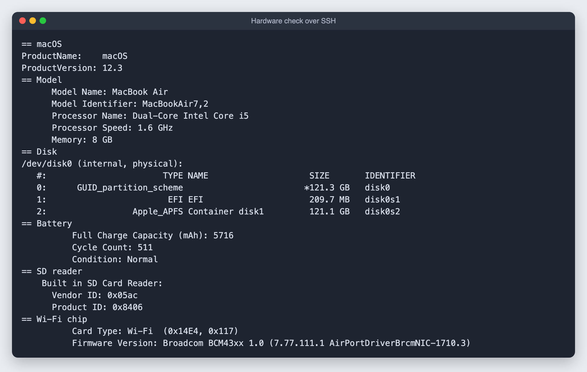
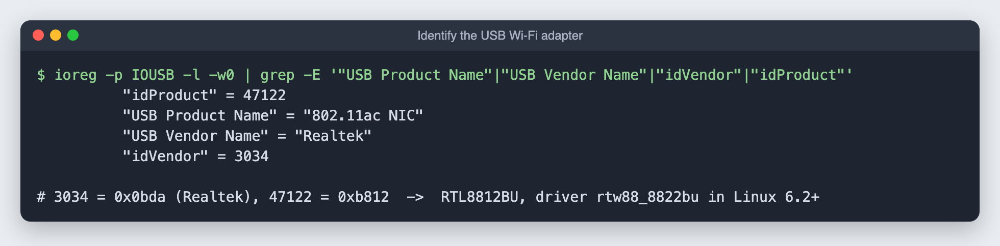

# 4. Check the hardware

**Goal:** before wiping anything, confirm the old Mac is healthy and find out which parts need special drivers on Linux. All of this runs over SSH from the main Mac.

## Model, disk, battery, SD reader and Wi-Fi chip

```bash
ssh <server-user>@<server-ip> '
sw_vers
system_profiler SPHardwareDataType | grep -E "Model Name|Model Identifier|Processor|Memory"
diskutil list internal physical
system_profiler SPPowerDataType | grep -E "Cycle Count|Condition|Full Charge Capacity"
system_profiler SPCardReaderDataType | head -12
system_profiler SPAirPortDataType | grep -E "Card Type|Firmware Version" | head -2'
```



How to read it:

| Line | Meaning |
|---|---|
| `MacBookAir7,2` | 13-inch, Early 2015. It has an SD card slot. |
| `121.3 GB` disk | The 128 GB SSD. Plan on external storage. |
| `Cycle Count: 511`, `Condition: Normal` | Battery is healthy. Full charge is about 80% of a new one (7,150 mAh). Safe to run plugged in, but check for swelling now and then. |
| `Card Type: Wi-Fi (0x14E4, 0x117)` | `14E4` is Broadcom, `0x117` is the BCM4360. Linux needs the proprietary `wl` driver for it, which is why this build uses Ubuntu Desktop. |

## The USB Wi-Fi adapter

Plug it into the old Mac, then list USB devices:

```bash
ssh <server-user>@<server-ip> "ioreg -p IOUSB -l -w0 | grep -E '\"USB Product Name\"|\"USB Vendor Name\"|\"idVendor\"|\"idProduct\"'"
```



macOS shows the IDs in decimal. Convert them to hex to look them up: `printf '%04x:%04x\n' 3034 47122` gives `0bda:b812`. That is a Realtek **RTL8812BU**, handled by the `rtw88_8822bu` driver built into Linux 6.2 and newer, so current Ubuntu supports it with nothing to install.

Some of these adapters first show up as a tiny "driver disc." Ubuntu switches them to Wi-Fi mode automatically.

## If the Mac goes quiet

While I was checking the adapter, the old Mac stopped answering. It had started a macOS update (12.3 to 12.7.6). Let an update finish: interrupting one can leave the Mac unable to start. Your SSH key survives the update.

Next: write the Ubuntu installer to the 2TB drive (coming next).
