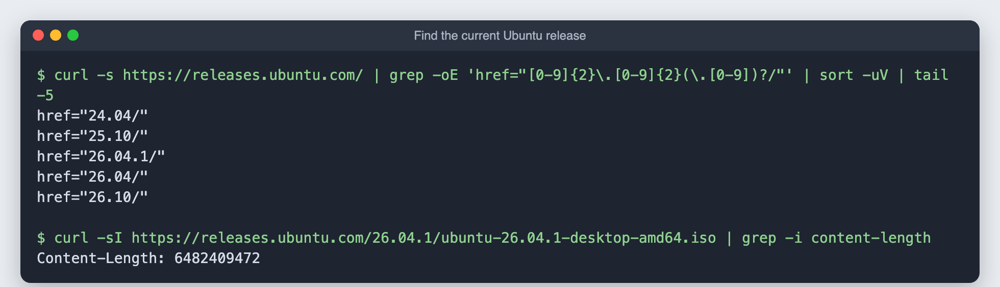
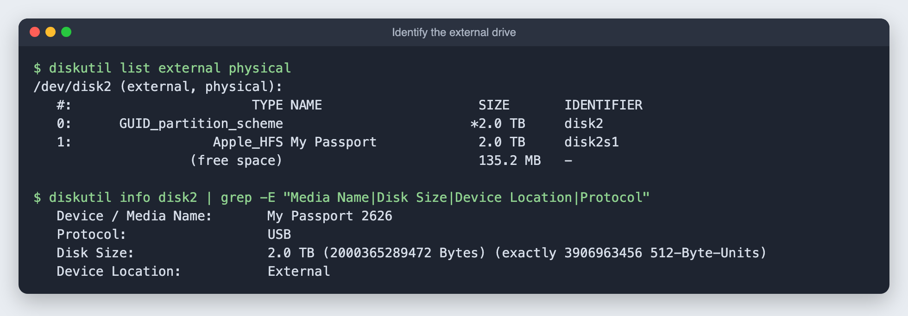
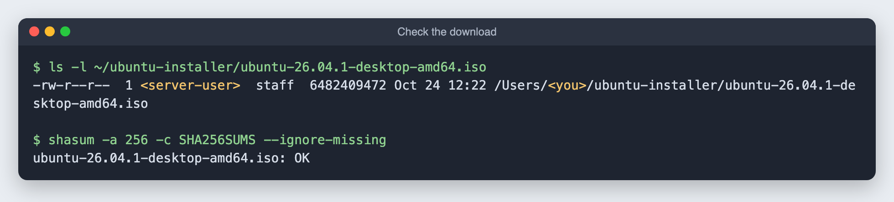
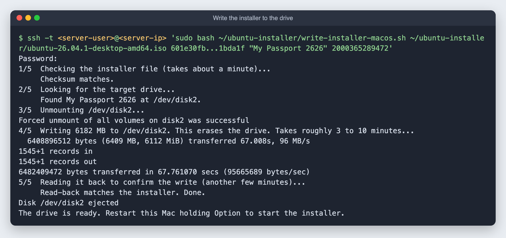

# 5. Write the Ubuntu installer to the external drive

**Goal:** turn the 2TB external drive into a bootable Ubuntu installer, from the main Mac, over SSH. Later the same drive gets reformatted as server storage.

**Time:** about 20 minutes, mostly waiting.

> **This erases the entire drive.** Check what is on it first (step 2).

## Why the external drive

The drive was going to be erased and reformatted for the server anyway, so using it as the installer first means no USB stick or SD card to buy. Any USB drive of 8 GB or more works the same way.

## Step 1: pick the right Ubuntu

Use the newest **LTS** (long-term support) release. LTS versions get security updates for five years; the in-between releases only get nine months.

```bash
curl -s https://releases.ubuntu.com/ | grep -oE 'href="[0-9]{2}\.[0-9]{2}(\.[0-9])?/"' | sort -uV | tail -5
```

LTS releases end in `.04` in even years. At the time of writing that is **26.04.1**. Use the **Desktop** image, not Server, because it can install the driver for this Mac's Broadcom Wi-Fi ([why](01-plan.md#why-ubuntu-desktop-and-not-ubuntu-server)).



## Step 2: find the drive and check what is on it

Plug the drive into the old Mac, then from the main Mac:

```bash
ssh <server-user>@<server-ip> 'diskutil list external physical'
```



Note three things: the disk number (`disk2` here), the name, and the exact size in bytes (`diskutil info disk2`). The write script uses the name and size together so it can never pick the wrong disk.

Look inside before erasing, **including the Trash**. Files you deleted on a Mac stay in a hidden `.Trashes` folder on the drive until you empty it:

```bash
ssh <server-user>@<server-ip> 'ls -lA "/Volumes/My Passport"; du -sh "/Volumes/My Passport/.Trashes/$(id -u)"'
```

My "empty" drive turned out to have about 1 GB of old documents in its Trash. I decided I did not need them. If you do, copy them off first.

**If the drive shows up as `0 B` and never mounts:** macOS's disk service can get stuck, especially right after a macOS update. Unplugging and replugging did not fix it for me. Restarting the Mac did.

## Step 3: download the installer and check it

Download straight onto the old Mac (about 6.5 GB), along with the official checksum list:

```bash
ssh <server-user>@<server-ip> 'mkdir -p ~/ubuntu-installer && cd ~/ubuntu-installer &&
  curl -O https://releases.ubuntu.com/26.04.1/SHA256SUMS &&
  curl -L -C - -O https://releases.ubuntu.com/26.04.1/ubuntu-26.04.1-desktop-amd64.iso &&
  shasum -a 256 -c SHA256SUMS --ignore-missing'
```

`OK` at the end means the file is exactly what Ubuntu published. `-C -` lets you rerun the command to resume an interrupted download.



## Step 4: write it to the drive

Writing to a whole disk needs administrator rights, so this step asks for the **old Mac's password**. That is why you run it yourself rather than letting a script or assistant type it.

Copy [`scripts/write-installer-macos.sh`](../scripts/write-installer-macos.sh) to the old Mac, then run it. The `-t` flag lets SSH show the password prompt:

```bash
scp scripts/write-installer-macos.sh <server-user>@<server-ip>:ubuntu-installer/
ssh -t <server-user>@<server-ip> 'sudo bash ~/ubuntu-installer/write-installer-macos.sh ~/ubuntu-installer/ubuntu-26.04.1-desktop-amd64.iso <sha256-from-SHA256SUMS> "My Passport 2626" 2000365289472'
```

The script:

1. Checks the installer file against its checksum again.
2. Finds the drive by **name, exact size and "External"**, and stops if anything is off.
3. Unmounts it.
4. Writes the image with `dd`, showing progress.
5. Reads the drive back and checks it against the same checksum, then ejects it.



Nothing shows while you type the password. That is normal.

On USB 3 the write itself took about 70 seconds at 96 MB/s. The two checksum checks took longer than the write.

## Next

Restart the old Mac while holding **Option**. Pick the orange **EFI Boot** icon to start the Ubuntu installer. That part happens on the old Mac's screen and is covered in the next guide.
