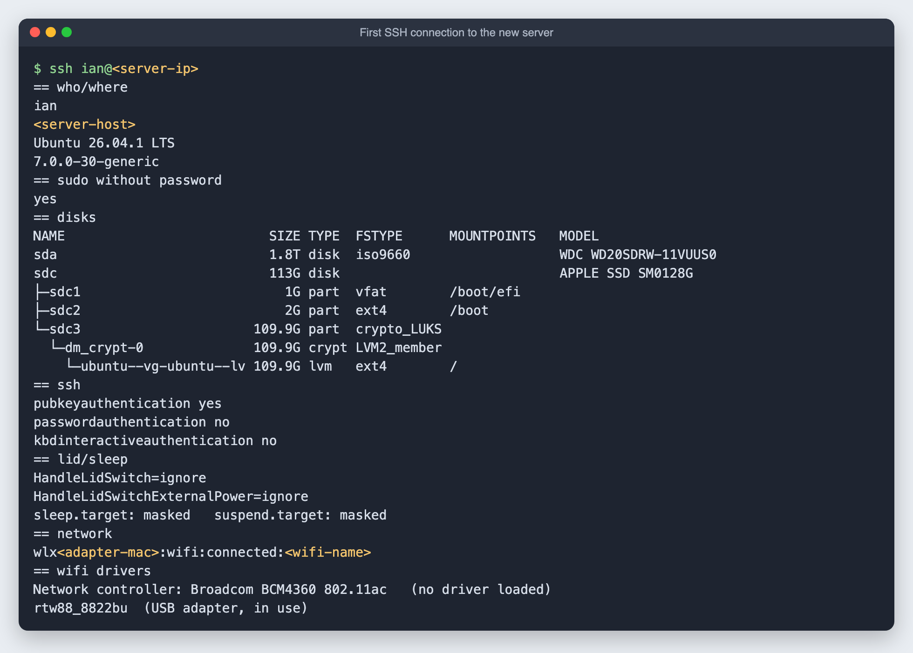

# 6. Install Ubuntu and hand it over to SSH

**Goal:** install Ubuntu Desktop on the old Mac's internal SSD, then make it reachable from the main Mac so nobody has to sit at it again.

**Time:** about 30 minutes, mostly waiting. This is the only part done at the old Mac's own keyboard and screen, so it is described in text.

## Step 1: start the installer

1. Plug the installer drive into the old Mac.
2. Restart. **As soon as the screen goes black, press and hold the Option (⌥) key** until a gray screen with startup icons appears.
3. Pick the orange **EFI Boot** icon (not "Macintosh HD") and press Return.
4. Choose **Try or Install Ubuntu**.

If the Mac starts macOS instead, you let go of Option too early or pressed it too late. Try again.

## Step 2: run the installer

1. Language, then accessibility and keyboard.
2. **Connect to Wi-Fi.** Plug in a USB Wi-Fi adapter if the built-in Wi-Fi shows no networks (see [the hardware check](04-hardware-check.md)).
3. **Install Ubuntu** > **Interactive installation** > **Default selection**.
4. Tick **Install third-party software for graphics and Wi-Fi hardware**.
5. **Erase disk and install Ubuntu.** When asked which disk, pick the **~121 GB APPLE SSD**, never the external drive.
6. **Encryption:** see the note below before you choose.
7. Create your account and computer name, pick the time zone, and install.
8. Click **Restart now**. Unplug the installer drive when it asks, and press Return.

### Optional: a fully automated install

The installer can also read every answer from a file (**Automated installation**, then type a URL). [`scripts/make-autoinstall.py`](../scripts/make-autoinstall.py) builds that file: it targets the smallest disk, installs SSH with your key and sets the server power options. Serve it from your main Mac with `python3 -m http.server 8000 --bind <control-mac-ip>` and type `http://<control-mac-ip>:8000/autoinstall.yaml` into the installer.

I built this but skipped the URL step by accident, so my install was interactive. Step 3 covers the same ground afterward.

### About disk encryption

My install ended up with **full-disk encryption** (LUKS) on the internal SSD. That protects the data if the laptop is stolen, but the machine **stops at a passphrase prompt on every restart** until someone types it at the keyboard. For a server that should come back by itself after a power cut, decide this up front:

| Choice | After a restart |
|---|---|
| No encryption | Comes back by itself |
| Encryption | Waits for the passphrase, unless you add remote or automatic unlocking |

What I chose to do about it is in the next guide.

## Step 3: one line to hand it over

A fresh Ubuntu Desktop has no SSH server, so this one step has to be typed at the machine. [`scripts/bootstrap-ubuntu.sh`](../scripts/bootstrap-ubuntu.sh) does everything needed to manage it remotely:

- installs the SSH server and adds the main Mac's public key
- turns off password logins over SSH (key only)
- lets your user run `sudo` without a password, so the main Mac can manage the machine
- ignores the lid and turns off sleep
- reports its address back to the main Mac

Serve it from the main Mac (with the `__CONTROL_KEY__` and `__CONTROL_IP__` placeholders filled in), then **on the old Mac** open Terminal (**⌘**, type `terminal`, Return) and type:

```text
wget <control-mac-ip>:8000/go
sudo bash go
```

**The trade-off of passwordless sudo:** anyone with the main Mac's SSH key gets full control of the server. With password logins off and the key never leaving the Mac, that is reasonable at home. To undo it: `sudo rm /etc/sudoers.d/90-<user>-nopasswd`.

## What went wrong, so you can skip it

- **The "Run" button in a chat or docs app runs commands on the computer you are using**, not the one you are setting up. This command must be typed on the new machine's own keyboard. The prompt tells you where you are: it shows the new username and computer name.
- **One missing digit.** Typing `192.68...` instead of `192.168...` gives `Connection timed out`. If `ping` to the address works but `wget` times out, compare the two lines character by character.
- **A file server started from a sandboxed tool may be unreachable from other machines** even though it answers on the same computer. Test it from a second device before relying on it. I checked from the Android phone.
- **Avoid `-qO-` when someone types it by hand.** The capital O looks like a zero. Two simple commands (`wget` then `sudo bash go`) are easier.

## Step 4: check it from the main Mac

```bash
ssh <server-user>@<server-ip>
```



- Ubuntu 26.04.1 is on the **APPLE SSD**. The external drive was untouched.
- SSH accepts keys only, and sudo works without a password.
- The lid is ignored and sleep is masked.
- Wi-Fi runs through the **USB adapter** (`rtw88_8822bu`). The built-in Broadcom chip has no driver loaded yet, because the third-party driver option did not install `wl`. That is fine while the adapter works; adding `broadcom-sta-dkms` later would give a second Wi-Fi path.

Tip: give the server's address a reservation in your router so it never changes.

Next: [turn the external drive into storage](07-storage.md).
