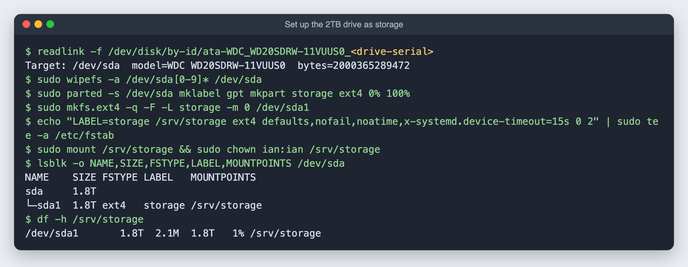

# 7. Turn the 2TB drive into server storage

**Goal:** erase the external drive (it was the installer) and mount it as permanent storage at `/srv/storage`. Done entirely over SSH.

**Time:** about 2 minutes.

> **This erases the drive.** The installer copy on it is no longer needed once Ubuntu is installed.

## Step 1: find the drive by its permanent ID

Linux names like `/dev/sda` can change between restarts. The IDs under `/dev/disk/by-id/` include the model and serial number, so they never point at the wrong disk:

```bash
ls -l /dev/disk/by-id/ | grep -v part
```

Before erasing anything, the commands below check that the target has the expected model and size and is **not** the disk the system runs from.

## Step 2: erase, partition, format and mount

```bash
DEV=/dev/disk/by-id/ata-WDC_WD20SDRW-11VUUS0_<drive-serial>
sudo wipefs -a ${DEV}*            # remove old partition signatures
sudo parted -s $DEV mklabel gpt mkpart storage ext4 0% 100%
sudo mkfs.ext4 -F -L storage -m 0 ${DEV}-part1
sudo mkdir -p /srv/storage
echo "LABEL=storage /srv/storage ext4 defaults,nofail,noatime,x-systemd.device-timeout=15s 0 2" | sudo tee -a /etc/fstab
sudo mount /srv/storage
sudo chown $USER:$USER /srv/storage
```

What the choices mean:

| Option | Why |
|---|---|
| `ext4` | Linux's standard file system: reliable, supports permissions, works with Docker. |
| `-L storage` | Gives it a name, so `/etc/fstab` can find it by label even if `/dev/sda` changes. |
| `-m 0` | ext4 normally reserves 5% (about 100 GB here) for the system. This is a data drive, so that is not needed. |
| `nofail` | **Important.** If the drive is unplugged, the server still starts instead of stopping at an emergency prompt. |
| `x-systemd.device-timeout=15s` | Waits at most 15 seconds for the drive at startup. |
| `noatime` | Skips writing "last read" times, which means fewer writes and a slightly faster disk. |



1.8 TB usable (2 TB in drive-maker units), mounted and writable.

## Next

[Unlock the encrypted disk over Wi-Fi](08-remote-unlock.md), then Docker and the first services, with their data on `/srv/storage`.
