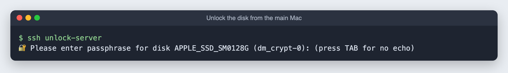
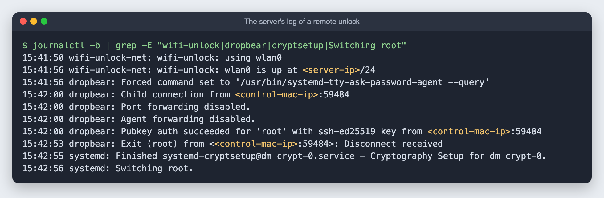

# 8. Unlock the encrypted disk over Wi-Fi

**Goal:** keep full-disk encryption, but type the passphrase from the main Mac after a restart instead of at the server's keyboard.

**Why:** with encryption on, the server stops at a passphrase prompt on every restart. A home server is supposed to sit in a corner with the lid closed. Remote unlock keeps the security of encryption (a stolen laptop is unreadable) and drops the need to walk over to it.

## How it works

Early in startup, before the real system is unlocked, Linux runs a small temporary system called the **initramfs**. I added a module to it that:

1. Loads the USB Wi-Fi adapter's driver and joins the home Wi-Fi.
2. Takes the server's usual address.
3. Starts **dropbear**, a tiny SSH server, on port **2222**.

Logging in to that SSH server does exactly one thing: it shows the passphrase prompt. There is no shell, no forwarding and no password login. Only the main Mac's key is accepted. As soon as the disk unlocks, the Wi-Fi and SSH server shut down, and normal Ubuntu takes over.

The server's own keyboard prompt still works too. Whichever answer comes first wins.

## Ubuntu 26.04 uses dracut

Most guides for this use `dropbear-initramfs`, which plugs into the older `initramfs-tools`. Ubuntu 25.10 and newer build the initramfs with **dracut** instead, so that package does nothing here. Check yours:

```bash
dpkg -l dracut initramfs-tools | grep ^ii
```

Most guides also assume a wired connection. This server only has Wi-Fi, so the module brings up Wi-Fi itself.

## The pieces

All in [`scripts/dracut/60wifi-unlock/`](../scripts/dracut/60wifi-unlock/):

| File | Job |
|---|---|
| `module-setup.sh` | Tells dracut what to copy in: the Wi-Fi driver and firmware, `wpa_supplicant`, `dropbear`, the key and the two services |
| `wifi-unlock-net.sh` | Finds the Wi-Fi adapter, joins the network and sets the address. Undoes it all before normal startup |
| `wifi-unlock-net.service` | Runs that script early in boot |
| `wifi-unlock-ssh.service` | Runs dropbear, limited to the passphrase prompt |

[`scripts/setup-remote-unlock.sh`](../scripts/setup-remote-unlock.sh) prepares the settings and builds a **test** image without touching the normal one:

- copies the Wi-Fi network from netplan and stores the **derived WPA key, not the Wi-Fi password**
- creates a separate host key for the unlock SSH server
- allows the same keys that can already log in
- installs the module and builds `/boot/initrd.img-<kernel>-unlocktest`

```bash
sudo apt install dropbear-bin
sudo bash setup-remote-unlock.sh <server-ip>/24 ./dracut/60wifi-unlock
```

## Test it once before trusting it

Changing the startup image can stop a machine from starting. So it gets one trial run first:

1. A one-time boot menu entry ("Ubuntu remote unlock test") that uses the test image.
2. `sudo grub-reboot "Ubuntu remote unlock test" && sudo reboot` uses it for **one** restart only. If anything had failed, the keyboard prompt was still there, and the next restart would have gone back to normal.

On the main Mac, two shortcuts in `~/.ssh/config`:

```
Host homeserver
    HostName <server-ip>
    User <server-user>

Host unlock-server
    HostName <server-ip>
    Port 2222
    User root
    RequestTTY yes
```

The unlock server has its own host key. I added it to `~/.ssh/known_hosts` ahead of time, so the first connection does not ask "are you sure?".





Read the log as: Wi-Fi up at 15:41:56, the main Mac logs in with its key at 15:42:00, the passphrase is sent at 15:42:53, the disk unlocks at 15:42:55.

**Testing tip:** do not touch the server while testing. Its own screen shows the prompt too, and if someone types there first, the disk unlocks and the SSH server closes before the remote login arrives. My first two tests "passed" that way without proving anything. The log shows which path was used: a `Pubkey auth succeeded` line means it was remote.

## Make it permanent

```bash
echo 'add_dracutmodules+=" wifi-unlock "' | sudo tee /etc/dracut.conf.d/90-wifi-unlock.conf
sudo dracut --regenerate-all --force
sudo lsinitrd /boot/initrd.img-$(uname -r) | grep wifi-unlock     # should list the files
sudo rm /etc/grub.d/42_unlocktest /boot/initrd.img-*-unlocktest && sudo update-grub
```

Kernel updates rebuild the image with the module automatically, because of that `dracut.conf.d` file.

## Day to day

After any restart, from the main Mac:

```bash
ssh unlock-server
```

Type the encryption passphrase. About 2 seconds later the server finishes starting. If `ssh unlock-server` says "Connection refused," it is still starting up or already unlocked. Wait 10 seconds and try again.

## Things to know

- **The early-boot address is fixed** in `/etc/wifi-unlock/wifi-unlock.conf`. Reserve that address for the server in your router, so nothing else ever gets it.
- **If you change your Wi-Fi password**, rerun `setup-remote-unlock.sh`, then `sudo dracut --regenerate-all --force`. Until then, unlock at the keyboard.
- **What is not encrypted:** the startup image lives on the unencrypted `/boot` partition. It contains the derived Wi-Fi key and the unlock server's host key, but not the disk passphrase. Someone with physical access could learn how to join the Wi-Fi from it. That is the usual trade-off for remote unlock.
- **It only works on the home network.** The unlock server is not reachable from the internet, and should not be.
