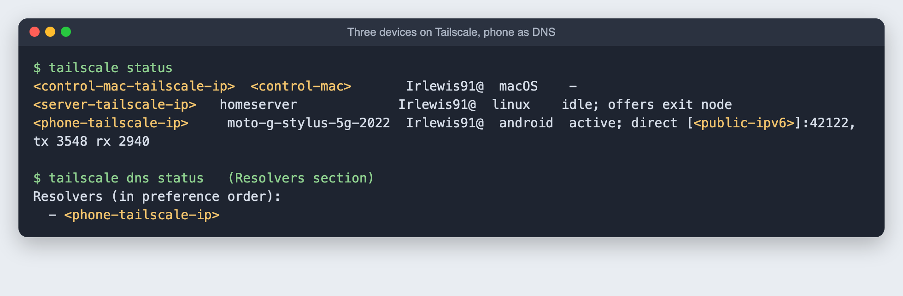

# 9. Tailscale: reach everything from anywhere

**Goal:** one private network across the server, the phone and the main Mac, wherever they are. The server also acts as a gateway into the home network and as an exit node for public Wi-Fi.

**Time:** about 15 minutes. Signing in and approving settings happen in your Tailscale account, so those steps are yours.

## Step 1: install on the server

```bash
sudo apt install -y curl
curl -fsSL https://tailscale.com/install.sh -o /tmp/ts-install.sh   # read it if you like, then:
sudo sh /tmp/ts-install.sh
```

Turn on IP forwarding, which the subnet router and exit node need:

```bash
printf "net.ipv4.ip_forward = 1\nnet.ipv6.conf.all.forwarding = 1\n" | sudo tee /etc/sysctl.d/99-tailscale.conf
sudo sysctl -p /etc/sysctl.d/99-tailscale.conf
```

## Step 2: bring it up

```bash
sudo tailscale up --hostname=homeserver \
  --advertise-routes=<home-subnet> \
  --advertise-exit-node \
  --accept-dns=false
```

| Option | Why |
|---|---|
| `--advertise-routes` | Offers the whole home network to your Tailscale devices (a "subnet router"). `<home-subnet>` is your network with a `.0/24` ending, from `ip route` |
| `--advertise-exit-node` | Lets your devices send all their internet traffic through home, for public Wi-Fi |
| `--accept-dns=false` | The server keeps its own DNS, so it keeps working even if the ad-blocking phone is down |

It prints a `https://login.tailscale.com/a/...` link. **Open that exact link and click Connect.** Being signed in to tailscale.com is not enough on its own; the link is what attaches this machine to your account.

## Step 3: approve in the admin page

At **login.tailscale.com/admin/machines**, on the server's **⋯** menu:

1. **Edit route settings:** tick the home subnet and **Use as exit node**, then **Save**.
2. **Disable key expiry.** Otherwise the server drops off every few months until someone signs it in again.

## Step 4: the other devices

- **Phone:** the Tailscale app from the Play Store. Sign in with the **same account**; mine first landed on a different one. Then turn **off "Use Tailscale subnets"** (see below).
- **Main Mac:** the Tailscale app from the Mac App Store, same account.



### Why the phone must not use the subnet route

The phone lives on the home network and answers DNS for it ([guide 10](10-adguard-and-battery.md)). With "Use Tailscale subnets" on, Android sends all traffic for `192.168.0.x` into Tailscale, including the phone's **replies** to DNS questions from other home devices. Those replies took a detour through the server and never arrived. Lookups over UDP simply timed out, while TCP still worked, which made it confusing to spot.

Check from the phone as root: `ip route get <control-mac-ip>` should say `dev wlan0`, not `dev tun1`.

## Using it

- **Exit node on public Wi-Fi:** Tailscale menu → **Exit Node** → **homeserver**.
- **Reach the server from anywhere:** `ssh <server-user>@homeserver` (MagicDNS name) or its Tailscale address.
- **Ad blocking everywhere:** set up in [guide 10](10-adguard-and-battery.md).
