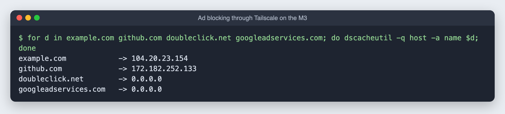
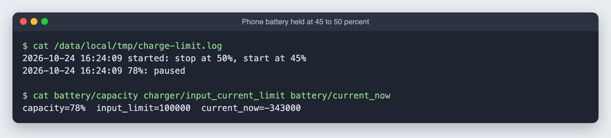

# 10. The phone as ad blocker, with a 50% battery limit

**Goal:** the old Android phone runs **AdGuard Home** around the clock, blocking ads and trackers for every device, at home and over Tailscale. Because it is always plugged in, its battery is held at 45 to 50%, which is far gentler on it than sitting at 100%.

Background on the phone itself (root, Termux, SSH): [android/README.md](../android/README.md).

## Part 1: AdGuard Home

### Install

AdGuard Home is a single program. Download the Linux ARM64 build into Termux and **check it against the official checksum**:

```bash
V=v0.107.79
mkdir -p ~/adguard && cd ~/adguard
curl -fsSL -o agh.tgz https://github.com/AdguardTeam/AdGuardHome/releases/download/$V/AdGuardHome_linux_arm64.tar.gz
curl -fsSL -o checksums.txt https://github.com/AdguardTeam/AdGuardHome/releases/download/$V/checksums.txt
grep linux_arm64.tar.gz checksums.txt; sha256sum agh.tgz      # the two must match
tar xzf agh.tgz
```

### Start it at every boot, as root

DNS uses port 53, and Android only lets **root** listen on ports below 1024. Magisk runs every script in `/data/adb/service.d/` as root at each boot, so the phone does not need the Termux app opened after a restart:

```bash
su -c "cp adguardhome-boot.sh /data/adb/service.d/adguardhome.sh && chmod 755 /data/adb/service.d/adguardhome.sh"
```

The script is [`android/adguardhome-boot.sh`](../android/adguardhome-boot.sh). It restarts AdGuard Home if it ever stops.

### First-time setup

Open `http://<phone-ip>:3000` and click through:

1. **Admin web interface:** All interfaces, port **80**
2. **DNS server:** All interfaces, port **53**
3. Create your own username and password

Afterward the admin page is at `http://<phone-ip>`.

### The certificate problem

The first lookups all failed. AdGuard's log said:

```
tls: failed to verify certificate: x509: certificate signed by unknown authority
```

AdGuard Home is a Linux program and looks for trusted certificates in `/etc/ssl`, which Android does not have. Inside Termux it borrows Termux's copy, but started by Magisk it has none, so every encrypted upstream DNS server looked untrusted. The fix, in the boot script, points it at Android's own certificate store:

```bash
export SSL_CERT_DIR="/apex/com.android.conscrypt/cacerts:/system/etc/security/cacerts"
```

### Use it everywhere through Tailscale

In **login.tailscale.com/admin/dns**:

1. **Nameservers** → **Add nameserver** → **Custom** → the phone's **Tailscale** address. Leave **Restrict to domain** off.
2. Turn on **Override DNS servers**.

Check from any Tailscale device: `tailscale dns status` should list the phone under **Resolvers**. Mine showed "no resolvers configured" until the nameserver was added again and saved properly.



Ad and tracker domains come back as `0.0.0.0`; normal sites resolve as usual. The default blocklist has about 190,000 entries.

**For devices without Tailscale** (TVs, guests): set your router's DHCP DNS server to the phone's home address.

## Part 2: hold the battery at 45 to 50%

### Why not ACC

ACC (Advanced Charging Controller) is the usual tool for this. On this phone it never managed to stop charging. ACC tests a charging switch by waiting for the phone to report "Not charging", and this phone keeps reporting **"Charging" even when no power flows in**. So ACC rejected every switch, and its own test hung.

### Finding a switch by hand

The candidates live in `/sys/class/power_supply/`. I set each to 0 for 8 seconds and watched `battery/current_now` (positive means charging):

| File | Result |
|---|---|
| `battery/constant_charge_current` | Write refused |
| `battery/input_current_limit` | Still charging |
| `usb/input_current_limit` | Still charging |
| **`charger/input_current_limit`** | **Current went negative: running on battery** |

The driver clamps the limit to 100 mA rather than 0, which is close enough: the phone draws slightly more than that, so the battery slowly drains.

### The script

[`android/charge-limit.sh`](../android/charge-limit.sh), installed to `/data/adb/service.d/charge-limit.sh`. Every minute it reads the battery level, cuts the charger at **50%** and restores it at **45%**. It writes the limit every cycle, because the driver can reset it when the cable is replugged.



It started at 78%, so the battery drains slowly to 50% before the 45 to 50% cycle begins. The log is at `/data/local/tmp/charge-limit.log`.

## After a phone restart

- AdGuard Home and the charge limit start on their own (Magisk).
- **Termux's SSH server does not.** Open the Termux app once, or install **Termux:Boot**.
