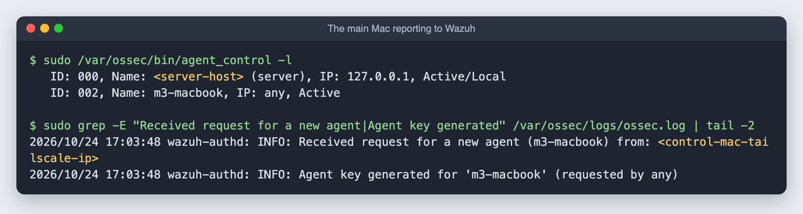

# 11. Wazuh: a security monitoring system (SIEM)

**Goal:** collect security events from every device in one place: logins, file changes, known vulnerabilities, suspicious activity. Searchable in a web dashboard.

**Time:** about 15 minutes, mostly waiting.

## Why Wazuh and not Wazuh plus ELK

Wazuh already includes an ELK-style stack: its **indexer** is a fork of Elasticsearch (OpenSearch), and its **dashboard** is a fork of Kibana. Running a second, separate ELK stack beside it would mean two Java search engines fighting over 8 GB of RAM. Wazuh alone covers both jobs.

| Part | Job |
|---|---|
| Wazuh indexer | Stores and searches events (OpenSearch) |
| Wazuh manager | Receives events from agents and applies the detection rules |
| Filebeat | Ships the manager's alerts into the indexer |
| Wazuh dashboard | The web interface (OpenSearch Dashboards) |

## Step 1: install everything on one machine

```bash
curl -fsSL -o wazuh-install.sh https://packages.wazuh.com/4.14/wazuh-install.sh
sudo bash wazuh-install.sh -a -i
```

- `-a` installs all four parts on this machine.
- `-i` skips the hardware check. The installer's list of supported systems ends at Ubuntu 24.04, but for newer versions it only warns; it worked on 26.04.

**Don't create `/var/lib/wazuh-indexer` before installing.** I made it ahead of time to put the data on the big drive, and the installer stopped immediately with `Wazuh indexer already installed`. Install first, move the data afterward.

## Step 2: move the search data to the big drive

The internal SSD is small. The indexer's data goes to the 2TB drive through a bind mount:

```bash
sudo systemctl stop wazuh-dashboard filebeat wazuh-indexer
sudo mkdir -p /srv/storage/wazuh-indexer
sudo rsync -aHAX /var/lib/wazuh-indexer/ /srv/storage/wazuh-indexer/
sudo mv /var/lib/wazuh-indexer /var/lib/wazuh-indexer.old && sudo mkdir /var/lib/wazuh-indexer
sudo chown --reference=/var/lib/wazuh-indexer.old /var/lib/wazuh-indexer /srv/storage/wazuh-indexer
echo "/srv/storage/wazuh-indexer /var/lib/wazuh-indexer none bind,nofail,x-systemd.requires=/srv/storage 0 0" | sudo tee -a /etc/fstab
sudo mkdir -p /etc/systemd/system/wazuh-indexer.service.d
printf "[Unit]\nRequiresMountsFor=/var/lib/wazuh-indexer\n" | sudo tee /etc/systemd/system/wazuh-indexer.service.d/storage.conf
sudo systemctl daemon-reload && sudo mount /var/lib/wazuh-indexer
sudo systemctl start wazuh-indexer && sleep 20 && sudo systemctl start filebeat wazuh-dashboard
```

`RequiresMountsFor` makes sure the indexer never starts on an empty folder if the drive is unplugged.


Memory: with everything running, the server uses about 4 GB of its 7.2 GB. The installer set the indexer's Java heap to 1 GB, which is plenty for a home network.

## Step 3: log in

The dashboard is at `https://<server-ip>` at home, or `https://homeserver` over Tailscale. The certificate is self-signed, so the browser warns once.

The installer generates the passwords and keeps them in a root-only archive. Read the admin password yourself, so it never ends up in a log or chat:

```bash
ssh -t <server-user>@<server-ip> "sudo tar -O -xf /root/wazuh/wazuh-install-files.tar wazuh-install-files/wazuh-passwords.txt" | grep -A1 "username: 'admin'"
```

Store it in a password manager.

## Step 4: agents

The manager monitors the server itself from the start (agent `000`). Other devices need the Wazuh agent:

- **Main Mac:** below.
- **Android:** there is no Wazuh agent for Android. Its logs can be forwarded later over syslog.

## Step 5: the agent on the main Mac

Download the Apple Silicon package and check that it is genuine before installing:

```bash
curl -fsSL -O https://packages.wazuh.com/4.x/macos/wazuh-agent-4.14.9-1.arm64.pkg
pkgutil --check-signature wazuh-agent-4.14.9-1.arm64.pkg   # Developer ID Installer: Wazuh Inc, notarized
```

Point it at the server's **Tailscale** address, so the Mac keeps reporting when it is away from home, then install:

```bash
echo "WAZUH_MANAGER='<server-tailscale-ip>'" > /tmp/wazuh_envs
echo "WAZUH_AGENT_NAME='m3-macbook'" >> /tmp/wazuh_envs
sudo installer -pkg wazuh-agent-4.14.9-1.arm64.pkg -target /
sudo /Library/Ossec/bin/wazuh-control start
```

### If the installer says "Upgrading"

Mine did, because a Wazuh agent had been installed on this Mac long ago. On an upgrade, the settings in `/tmp/wazuh_envs` are **ignored** and the old `/Library/Ossec/etc/ossec.conf` is kept. Mine still held the placeholder, so the agent stopped with:

```
wazuh-agentd: ERROR: (4112): Invalid server address found: 'MANAGER_IP'
```

Fix it by editing the file directly (a backup first):

```bash
sudo cp /Library/Ossec/etc/ossec.conf /Library/Ossec/etc/ossec.conf.before-fix
sudo perl -0pi -e 's#<address>MANAGER_IP</address>#<address><server-tailscale-ip></address>#' /Library/Ossec/etc/ossec.conf
sudo /Library/Ossec/bin/wazuh-control restart
```

### Renaming the agent

The old file also had no `<enrollment>` section, so the agent registered under the Mac's computer name (which includes my name) instead of `m3-macbook`. Wazuh cannot rename an agent in place. Remove it on the server and enroll it again:

```bash
# On the server: remove the old entry (use its ID from agent_control -l)
echo y | sudo /var/ossec/bin/manage_agents -r 001
```

On the Mac, [`scripts/rename-wazuh-agent-macos.sh`](../scripts/rename-wazuh-agent-macos.sh) stops the agent, backs up `ossec.conf`, adds an `<enrollment>` section with the new `<agent_name>`, empties `client.keys` so the agent asks for a new identity, and starts it again:

```bash
sudo bash rename-wazuh-agent-macos.sh
```

It shows up as **Pending** for a few seconds, then **Active** under a new ID.



### A note on enrollment

The all-in-one install accepts new agents on port 1515 **without a password**. Here the server is reachable only from the home network and Tailscale, so that is acceptable. To require one, set `<use_password>yes</use_password>` in the `<auth>` section of `/var/ossec/etc/ossec.conf` on the server and put the password in `/var/ossec/etc/authd.pass`.
