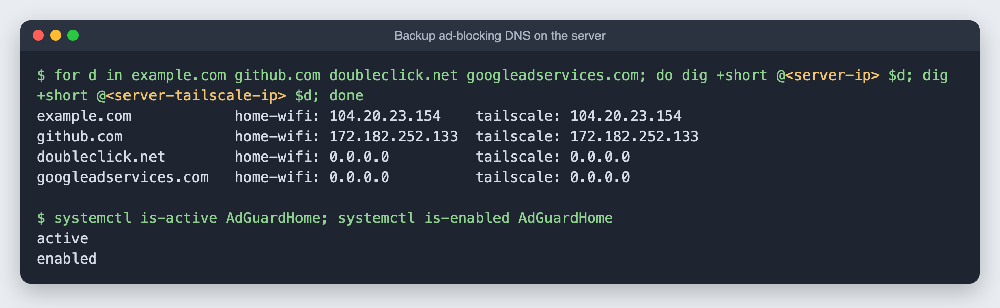

# 12. A backup ad-blocking DNS on the server

**Goal:** a second AdGuard Home on the server, with the same settings and blocklists as the phone, so name lookups keep working for every Tailscale device if the phone is off or restarting.

**Why:** with Tailscale's "Override DNS servers" on, every device sends **all** its lookups to the nameservers you list. With only the phone listed, a phone restart meant no websites loading anywhere. Two servers on two different devices remove that single point of failure.

**Time:** about 10 minutes.

## Step 1: free port 53 on the server

Ubuntu's own DNS helper, `systemd-resolved`, listens on port 53 at `127.0.0.53`. AdGuard Home needs that port on all addresses, so turn the helper's listener off and point the server's own lookups straight at the router:

```bash
sudo mkdir -p /etc/systemd/resolved.conf.d
printf "[Resolve]\nDNSStubListener=no\n" | sudo tee /etc/systemd/resolved.conf.d/10-adguard.conf
sudo ln -sf /run/systemd/resolve/resolv.conf /etc/resolv.conf
sudo systemctl restart systemd-resolved
getent hosts example.com     # the server can still look up names
```

The server itself keeps using the router's DNS, not AdGuard. That way it never depends on its own ad blocker.

## Step 2: install AdGuard Home, checksum verified

```bash
V=v0.107.79; cd /tmp
curl -fsSL -o agh.tgz https://github.com/AdguardTeam/AdGuardHome/releases/download/$V/AdGuardHome_linux_amd64.tar.gz
curl -fsSL -o sums.txt https://github.com/AdguardTeam/AdGuardHome/releases/download/$V/checksums.txt
grep linux_amd64.tar.gz sums.txt; sha256sum agh.tgz      # the two must match
sudo tar xzf agh.tgz -C /opt
```

## Step 3: copy the phone's settings

Rather than clicking through setup again, copy the phone's `AdGuardHome.yaml`. It carries the blocklists, upstream servers and your admin login (stored as a hash, not the password):

```bash
ssh -p 8022 <termux-user>@<phone-ip> 'su -c "cat ~/adguard/AdGuardHome/AdGuardHome.yaml"' \
  | ssh <server-user>@<server-ip> 'sudo install -m 600 /dev/stdin /opt/AdGuardHome/AdGuardHome.yaml'
```

Then change two things on the server: the admin page moves to port **3000** (port 443 belongs to Wazuh), and DNS listens on all addresses:

```bash
sudo python3 -c '
import yaml; p="/opt/AdGuardHome/AdGuardHome.yaml"; c=yaml.safe_load(open(p))
c["http"]["address"]="0.0.0.0:3000"; c["dns"]["bind_hosts"]=["0.0.0.0"]
open(p,"w").write(yaml.safe_dump(c, sort_keys=False))'
cd /opt/AdGuardHome && sudo ./AdGuardHome -s install     # systemd service, starts at boot
```

Admin page: `http://homeserver:3000`, same login as the phone.

## Step 4: test it



Same answers as the phone, and the same 191,610 blocking rules.

## Step 5: add it to Tailscale

In **login.tailscale.com/admin/dns** → **Add nameserver** → **Custom** → the server's **Tailscale** address, with **Restrict to domain** off. Both nameservers then appear under **Global nameservers**, and `tailscale dns status` lists both under **Resolvers**.

## Keeping them in step

The copy is a snapshot. If you add a blocklist or allow a site on one, do the same on the other, or copy the YAML again (Step 3) and restart with `sudo systemctl restart AdGuardHome`. The tool **adguardhome-sync** can automate that later.
