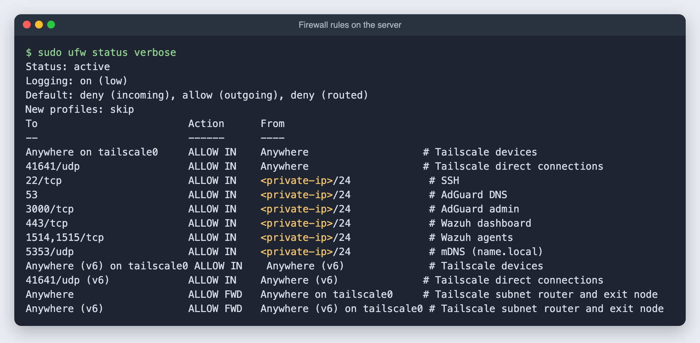
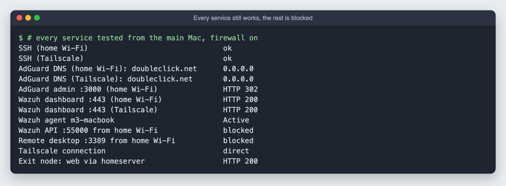
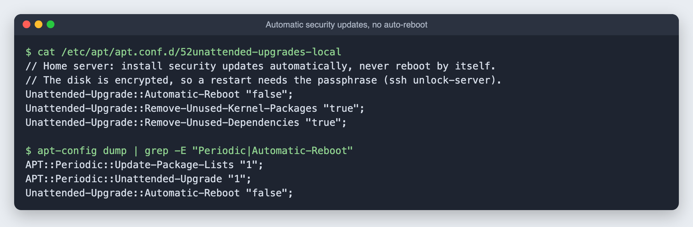

# 13. Firewall and automatic security updates

**Goal:** close every port that does not need to be open, and keep security patches coming in by themselves, without breaking Tailscale, SSH, remote unlock, AdGuard or Wazuh.

**Time:** about 15 minutes.

## What was open before

```bash
sudo ss -lntup     # every listening port, and which program owns it
```

Besides the services I meant to run, two surprises were reachable from the whole home network:

| Port | Program | Problem |
|---|---|---|
| 55000 | Wazuh API | The dashboard uses it locally. Nothing else needs it. |
| 3389 | GNOME Remote Desktop | Ubuntu Desktop listens for remote desktop connections out of the box |

## The rules

Two kinds of neighbors get different trust:

- **Tailscale devices** are all mine and signed in, so they may reach everything.
- **The home network** may reach only the services meant for it.

| Allowed | From | For |
|---|---|---|
| everything | Tailscale (`tailscale0`) | trusted devices |
| forwarding | Tailscale (`tailscale0`) | the subnet router and exit node |
| 41641/udp | anywhere | Tailscale's direct connections. Without it everything still works, but slower, through Tailscale's relays |
| 22 | home network | SSH |
| 53 | home network | AdGuard DNS |
| 3000 | home network | AdGuard admin page |
| 443 | home network | Wazuh dashboard |
| 1514, 1515 | home network | Wazuh agents |
| 5353/udp | home network | `name.local` discovery |

Everything else coming in is dropped. Outgoing traffic is not restricted.

**Remote unlock is not affected.** It runs in the early-boot system before Ubuntu, and with it the firewall, has started.

## Turn it on without locking yourself out

[`scripts/setup-firewall.sh`](../scripts/setup-firewall.sh) applies the rules with **ufw**. Before enabling anything, it starts a timer that switches the firewall **off again after 5 minutes**. If a rule were wrong and cut off SSH, the server would let you back in by itself.

```bash
sudo bash setup-firewall.sh <home-subnet>
```



Then test everything from another machine, and only when all of it works, cancel the timer:

```bash
sudo systemctl stop ufw-safety.timer
```



The exit node test is the one most likely to fail: ufw blocks forwarded traffic by default, which silently breaks a Tailscale exit node and subnet router. The `route allow in on tailscale0` rule is what keeps them working. To test, switch the main Mac to the exit node, load a page and switch back:

```bash
tailscale set --exit-node=homeserver && curl -sI https://example.com | head -1
tailscale set --exit-node=
```

## Automatic security updates

Ubuntu already had **unattended-upgrades** switched on for security updates. Two additions:

1. **Never restart by itself.** This is the important one. The disk is encrypted, so an automatic restart would leave the server stuck at the passphrase prompt, offline, until someone ran `ssh unlock-server`.
2. **Clean up** old kernels and unused packages, so the small `/boot` partition does not fill up.

```bash
sudo tee /etc/apt/apt.conf.d/52unattended-upgrades-local <<'EOF'
Unattended-Upgrade::Automatic-Reboot "false";
Unattended-Upgrade::Remove-Unused-Kernel-Packages "true";
Unattended-Upgrade::Remove-Unused-Dependencies "true";
EOF
```



**Tailscale** updates itself too: `sudo tailscale set --auto-update`.

**Wazuh is not updated automatically.** Its installer turns off its own package source on purpose, because the indexer, manager and dashboard must be upgraded together. Follow Wazuh's upgrade guide when a new version comes out.

## When a restart is needed

Some updates, kernels especially, only take effect after a restart. Check now and then:

```bash
ssh homeserver 'cat /var/run/reboot-required 2>/dev/null || echo "no restart needed"'
```

If one is needed, restart at a convenient time and unlock it from the main Mac:

```bash
ssh homeserver 'sudo reboot'
# about a minute later:
ssh unlock-server
```
