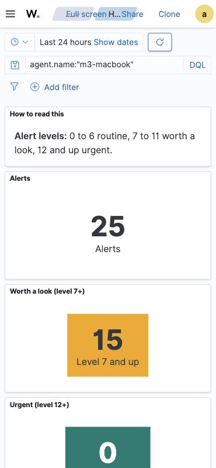

# 14. A home-network security dashboard you can open on your phone

**Goal:** one page in Wazuh that answers "is anything wrong at home?" at a glance, and opens cleanly on the main Mac, the Android phone, an iPhone or an iPad, from anywhere through Tailscale.

**Time:** about 20 minutes.

## What is on it

| Row | Panels |
|---|---|
| How to read it | Alert levels: 0 to 6 routine, 7 to 11 worth a look, 12 and up urgent |
| Numbers | **Alerts** · **Worth a look (7+)**, amber when above zero · **Urgent (12+)**, red when above zero · **Failed logins** · **Devices reporting** |
| Timeline | Alerts over time, one line per device |
| Breakdown | Alerts by device · by level · what kind of activity |
| Lists | Level 7+ alerts · failed logins by device and user · top alerts · known vulnerabilities by severity |

It opens on the last 24 hours and refreshes every 5 minutes. On a phone the panels stack top to bottom.



*(Filtered to one device for this screenshot, so no other device names show.)*

### Choosing the colors

My first version turned "Worth a look" **red** at 20 alerts. In practice most level-7 alerts are routine: Wazuh's rootcheck scans and new package installs. A dashboard that is always red teaches you to ignore red. So "worth a look" is now amber at most, and a separate **Urgent (level 12+)** box is the only one that turns red.

## Step 1: build it as code

The whole dashboard is generated by [`scripts/wazuh-dashboard/build.py`](../scripts/wazuh-dashboard/build.py): every chart, its query and its place on the grid. That makes it easy to tweak and rebuild, and to keep in Git:

```bash
python3 scripts/wazuh-dashboard/build.py > home-network.ndjson
```

It uses Wazuh's standard index patterns (`wazuh-alerts-*` and `wazuh-states-vulnerabilities-*`), so it keeps working alongside Wazuh's own pages.

## Step 2: import it without handling the password

The dashboard's import API needs the admin login. A small root-only helper on the server, `/root/wazuh/osd.sh`, reads the password from Wazuh's installer archive and passes it straight to `curl`. The password never appears in a terminal, a log or a chat:

```bash
scp home-network.ndjson <server-user>@<server-ip>:/tmp/
ssh <server-user>@<server-ip> 'sudo /root/wazuh/osd.sh dash POST "/api/saved_objects/_import?overwrite=true" -F file=@/tmp/home-network.ndjson'
```

`overwrite=true` means re-running it after a change updates the dashboard in place.

**A gotcha:** my first import added the header `securitytenant: global` and failed with `no permissions for [indices:data/write/bulk[s]]`, even as admin. Wazuh's dashboard does not use tenants, so leave that header out.

## Step 3: a real certificate, so phones open it without warnings

Wazuh ships a **self-signed** certificate. Phones show a full-page "connection not private" warning for it, and some browsers refuse it outright. Tailscale can issue a real **Let's Encrypt** certificate for the server's Tailscale name instead:

1. In **login.tailscale.com/admin/dns**, click **Enable HTTPS** (under HTTPS Certificates).
2. On the server, fetch the certificate and point the dashboard at it:

```bash
FQDN=$(tailscale status --json | python3 -c "import json,sys; print(json.load(sys.stdin)['Self']['DNSName'].rstrip('.'))")
sudo tailscale cert --cert-file /etc/wazuh-dashboard/certs/tailscale.crt \
                    --key-file  /etc/wazuh-dashboard/certs/tailscale.key "$FQDN"
sudo chown wazuh-dashboard: /etc/wazuh-dashboard/certs/tailscale.*
sudo chmod 400 /etc/wazuh-dashboard/certs/tailscale.*
# in /etc/wazuh-dashboard/opensearch_dashboards.yml:
#   server.ssl.key: "/etc/wazuh-dashboard/certs/tailscale.key"
#   server.ssl.certificate: "/etc/wazuh-dashboard/certs/tailscale.crt"
sudo systemctl restart wazuh-dashboard
```

3. **Renewal.** Let's Encrypt certificates last 90 days. A weekly systemd timer runs [`scripts/renew-dashboard-cert.sh`](../scripts/renew-dashboard-cert.sh), which asks Tailscale for a fresh certificate when it is close to expiring and restarts the dashboard only if it changed.

**Privacy trade-off:** every public certificate is recorded in public Certificate Transparency logs, so the name `homeserver.<tailnet>.ts.net` becomes publicly visible. It is only reachable from your own Tailscale devices, so knowing it is not useful to anyone else.

From now on, use the Tailscale name, not the IP address (the certificate only matches the name):

```
https://homeserver.<tailnet>.ts.net/app/dashboards#/view/home-network-security
```

## Step 4: on the phone

Open that link in Chrome on Android (or Safari on iPhone), log in, then **Add to Home screen**. It works anywhere Tailscale is on.

## What it found on day one

Vulnerabilities on the main Mac, all in software that was already installed:

| Where | What | Fix |
|---|---|---|
| Personal Python packages (`~/Library/Python/3.9`) | pillow, urllib3, anyio and others | `python3 -m pip install --user --upgrade <package>` |
| Apple's Command Line Tools Python | old pip and setuptools | Software Update, when Apple updates the tools |
| App Store apps | GarageBand, Keynote, Pages | App Store updates |

That is exactly what this kind of dashboard is for: things you would never have checked by hand.
